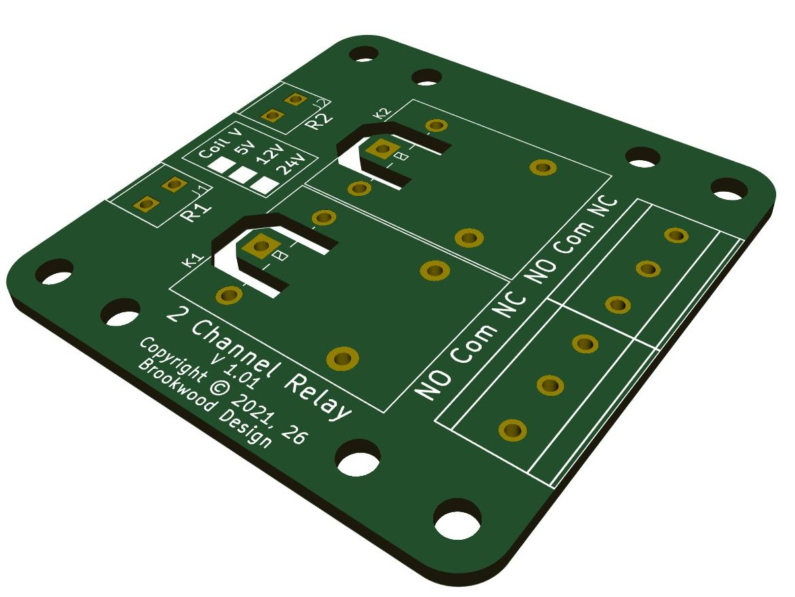
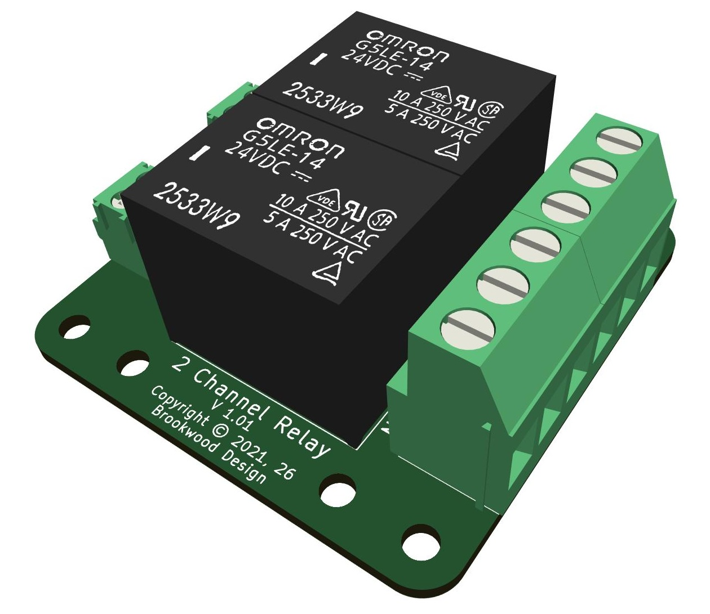
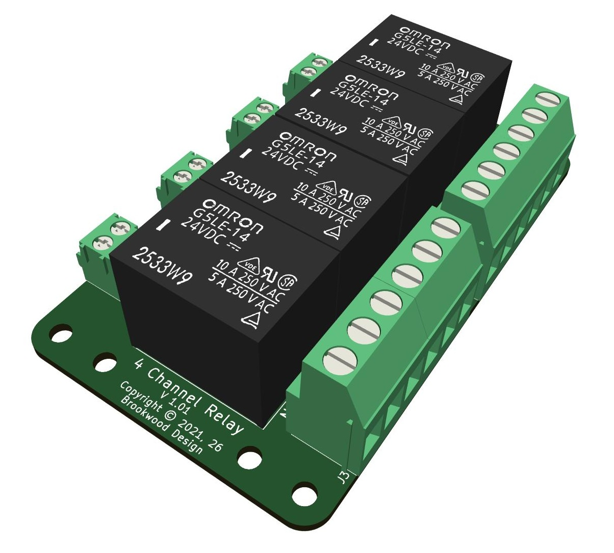
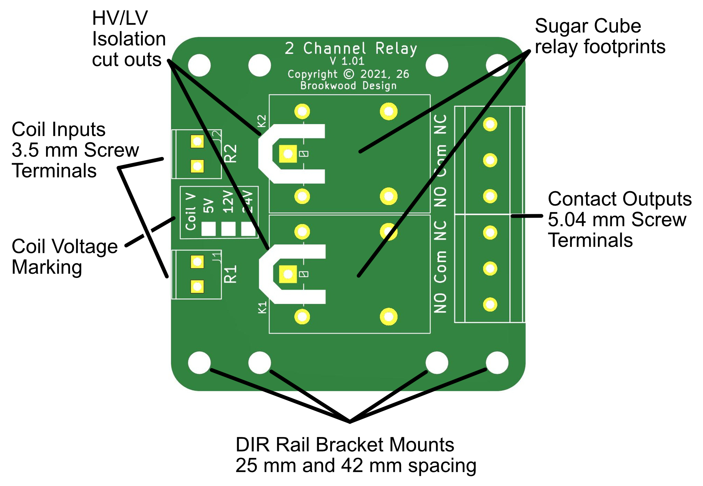
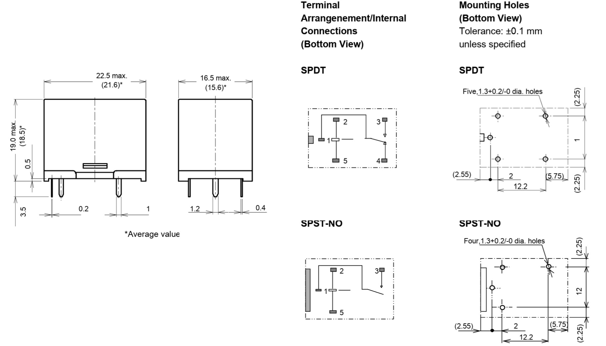
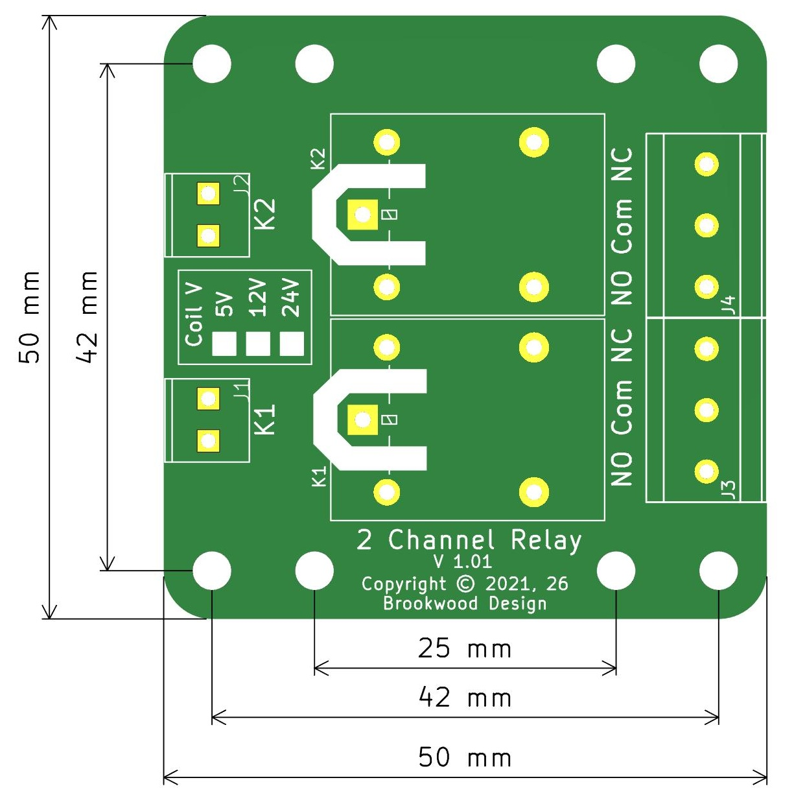
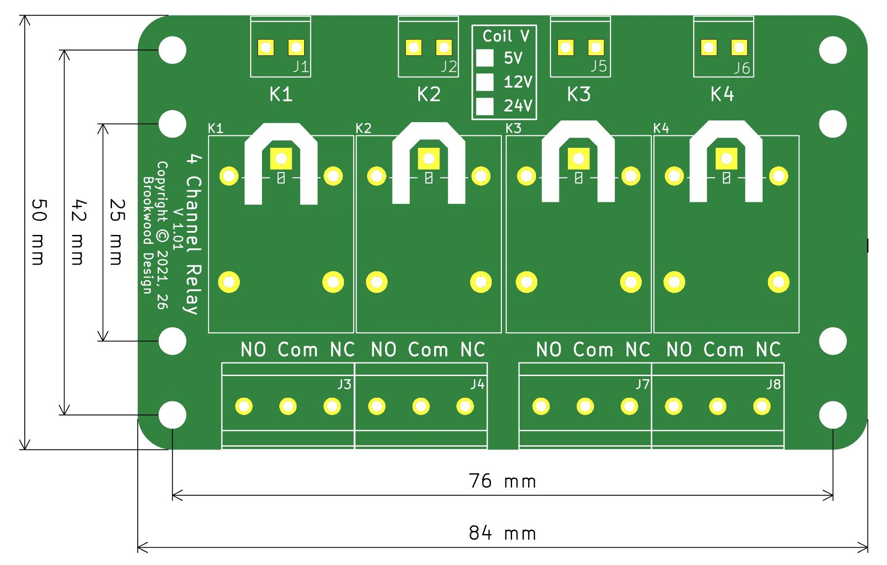

# Relay Boards

This repository is for a family of simple 2 and 4 channel, DIN Rail mountable relay boards. They are compatible with the industry standard "Sugar Cube" relay format in SPDT or SPST conmfiguration.

## Table of Contents
1. [Images](#Images)
2. [Features](#Features)
3. [Compatible Relays](#Compatible-Relays)
4. [PCB dimensions](#PCB-dimensions)
5. [DIN Rail Mounting](#DIN-Rail-Mounting)
6. [PCB Gerbers](#PCB-Gerbers)
7. [Bill of Materials](#Bill-of-Materials)

## Images

## Features

## Compatible Relays

The Boards use an standard industry-wide "Sugar Cube" (or "Cubic") 5-pin PCB footprint. It features a layout with a width of approximately 16.5 mm and a length of 22.5 mm.

Compatible Relays:
- Omron/Aratus: G5LE Series
- Panasonic: JS Series (e.g., JS1-12V-F)
- TE Connectivity / OEG: PCE Series or ORWH Series
- Tyco / Potter & Brumfield: T72 Series or T7N Series
- Hongfa: HF3FF Series (e.g., HF3FF/012-1ZST)
- Song Chuan: 833H Series (e.g., 833H-1C-C)
- Finder: 36.11 Series
- and more...

Note: We have not verified all of the above relays. Before ordering, please verify that the relays you choose comply with the following layout. 

## PCB dimensions

## DIN Rail Mounting

DIN Rail mounting brackets are availabele They can be 3D Printed in the material of your choice. PLA works well for environments that are below 60C. For higher temperature environments, use an appropriate material.  

To download a 3D Manufacturing Format file, click on the link and select the download option on that page. Print 2 pieces.

[3D model in .3MF format](https://github.com/phil-barrett/RelayBoards/blob/main/DIN%20Rail%20Brackets/DINRail_60mm(42mm)x8mm.3mf)

## PCB-Gerbers

Zip files that contain all the necessary layers to have a PCB production house create the PCBs. I have used them with JLCPCB.  

Click on a link below and select the download option on the resulting page.

[2 Channel Gerbers](https://github.com/phil-barrett/RelayBoards/blob/main/Gerbers/Relay_Board_2X_Ver_1.0.zip)

[4 Channel Gerbers](https://github.com/phil-barrett/RelayBoards/blob/main/Gerbers/Relay_Board_4X_DIN_C45.zip)

## Bill of Materials

These components can be sourced from many places. 

| Item | Mouser Part # | DigiKey Part # | Description |
| :---: | :---: | :---: | :---: |
| Relay | 653-G5LE-1A4-DC12 | Z2352-ND | G5LE-1A4 DC12 but see [Compatible Relays](#Compatible_Relays) |
| 3.5 mm Screw Terminal 2 pin | 640-TAD05-02-1-L-G | 2073-TAD05-02-1-L-G-ND | Standard 3.5 mm, numerous sources |
| 5.08 mm Screw Terminal 3 pin | 640-TBJ05-03-1-G-G | 2073-TBJ05-03-1-G-G-ND | Standard 5.08 mm, numerous sources |

